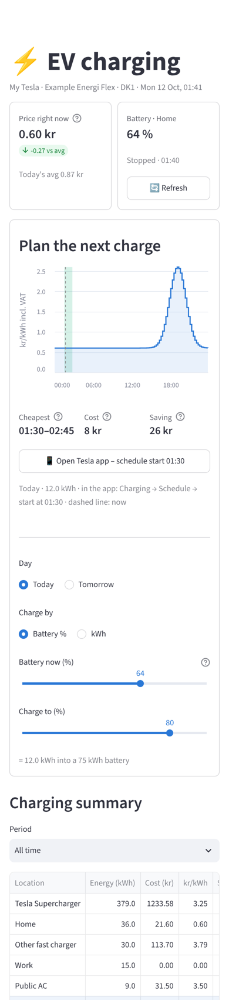
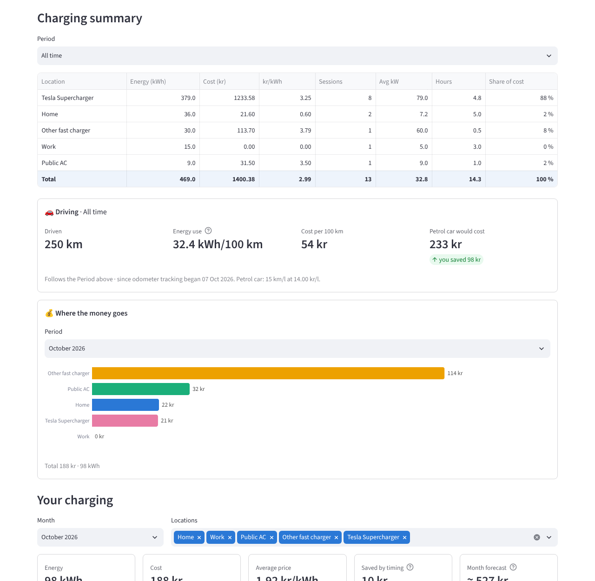

# ⚡ EV Charging Tracker (Denmark · Tesla)

**What did my car actually cost me this month – and when should I charge?**

A small self-hosted app that logs every time your Tesla charges and works out the **real cost**:
the hourly Danish electricity price for your area, your grid company's tariff, taxes, VAT and your
supplier's markup at home – and the actual price at public chargers and Superchargers.
You open it on your phone like an app.

> 🇩🇰 **På dansk:** En lille app du selv kører, som logger hver opladning af din Tesla og regner den
> rigtige pris ud – timepris (spotpris + nettarif + afgifter + moms + dit elselskabs tillæg) derhjemme,
> og de faktiske priser ved offentlige ladere og Superchargere. Gratis at køre på en gratis Google Cloud-server.
> Opsætningen er beskrevet på engelsk herunder.

<p>
  
  &nbsp;
  
</p>

## What it does

- **Logs every charge automatically** – kWh, cost, location, start/end time, battery % – checking the car every 15 minutes (never waking it).
- **Real home price per 15 minutes** – spot price, grid tariff ("Nettarif C time"), Energinet tariffs, elafgift, VAT and your supplier's markup, from [Energi Data Service](https://www.energidataservice.dk/).
- **Plan the next charge** – today's/tomorrow's price curve with the cheapest window for the kWh or battery % you need.
- **Five locations** – Home, Work, Tesla Supercharger, other fast chargers, public AC – recognised by GPS and charger type.
- **Exact Supercharger costs** – fetched from Tesla's billing history (euro converted to kroner), including past visits.
- **Public charging prices** – recognises the station and company ([Open Charge Map](https://openchargemap.org/)), remembers the price you enter per station/company.
- **Dashboard** – live "charging now" card, charging summary per location, cost per day/month, driving costs per 100 km vs a petrol/diesel car, month forecast, CSV export.
- **Phone notifications** (free [ntfy](https://ntfy.sh/) app) – charging finished, plugged in at an expensive time, tonight's cheapest hours.
- **Private by design** – runs on *your* server; nothing is sent anywhere except to Tesla, Energi Data Service and (optionally) Open Charge Map / ntfy.

## What you need – and what it costs

| | Cost |
|---|---|
| A Tesla (Model 3/Y/S/X) and a Danish electricity contract | – |
| Server: Google Cloud **e2-micro** (always-free tier) | 0 kr |
| [Tesla developer account](https://developer.tesla.com) (Fleet API) | 0 kr – includes a $10/month credit; one car normally stays within it. A payment method is required. |
| GitHub account (to host the public key on GitHub Pages) | 0 kr |
| [Tailscale](https://tailscale.com) (private access from your phone) | 0 kr for personal use |

Setup takes about **10-15 minutes** once. Some terminal copy-paste is needed for the server; everything else is done on the setup page in the app.

## Install

### 1. Create the free server
Follow **[deploy/SERVER_SETUP.md](deploy/SERVER_SETUP.md)** (Google Cloud account, e2-micro server, Tailscale).
Then, in the server's SSH window:

```bash
sudo apt-get install -y git
git clone https://github.com/santhom24/ev-charging-tracker.git ev_cost
cd ev_cost
bash deploy/install.sh
```

### 2. Open the app on your phone
With Tailscale on, open **`http://ev-server:8501`** (or the server's `100.x.x.x` address from the Tailscale app).
On iPhone: Share → **Add to Home Screen**. On Android: ⋮ → **Add to Home screen**.

### 3. Follow the setup page
The first time, the app opens a setup page with four tabs:

1. **Electricity** – price area (DK1/DK2), your grid company (picked from a list), supplier and markup ("tillæg" on your bill).
2. **Car & charging** – charger kW, battery size, home position (or set it later from the car's GPS).
3. **Tesla** – create a key pair, publish the public key on GitHub Pages, create the app at developer.tesla.com, register, log in. Each step is explained on the page.
4. **Extras** – fuel-car comparison, notifications.

The logger starts on its own as soon as the Tesla login is done.

### Optional
- **Station names for public charging:** free API key from openchargemap.org → paste it under ⚙️ Station lookup.
- **Notifications:** install the ntfy app and subscribe to the topic shown under 🔔 Phone notifications.
- **Share with your partner:** Tailscale → Machines → ev-server → ⋯ → Share.

## Update to a new version
```bash
cd ~/ev_cost && bash deploy/update.sh
```

## Good to know
- **Denmark only** for the home price (Energi Data Service data). Other countries would need their own price source.
- **Tesla only** today. Other brands could be added via their home charger's API (Easee, Zaptec, Monta …).
- Costs are **estimates** where the real price isn't available (public chargers until you enter the price; charging losses ≈ 10 % at home). Compare with your electricity bill and adjust *efficiency* if needed.
- Not affiliated with Tesla, Energinet or any electricity company.

## Security
Your personal files stay on your server and are excluded from Git: `settings.toml`, `tesla_secrets.toml`, `tokens.json`, `private-key.pem`, `charging.db`.
**Never** upload or share them – together they give access to your car's data. The dashboard is only reachable through your private Tailscale network.

## Files
| File | What it does |
|---|---|
| `dashboard.py` | the app (Streamlit) |
| `setup_page.py` | first-run setup and ⚙️ Settings |
| `logger.py` | watches the car, records charges (runs as a service) |
| `price_engine.py` | all-in Danish price per 15 minutes |
| `public_prices.py` | station lookup, remembered prices, Supercharger bills |
| `tesla_client.py`, `tesla_auth.py` | Tesla Fleet API and login (also usable from the command line) |
| `deploy/` | server install, update and service files |

## License
MIT – free to use, change and share. See [LICENSE](LICENSE).
